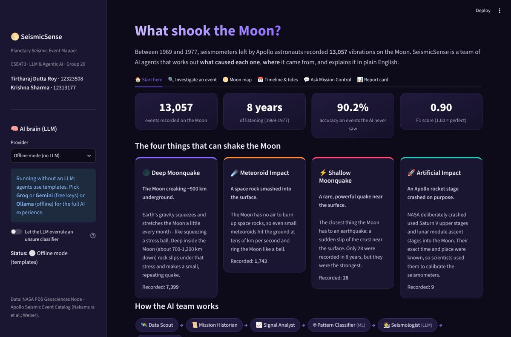
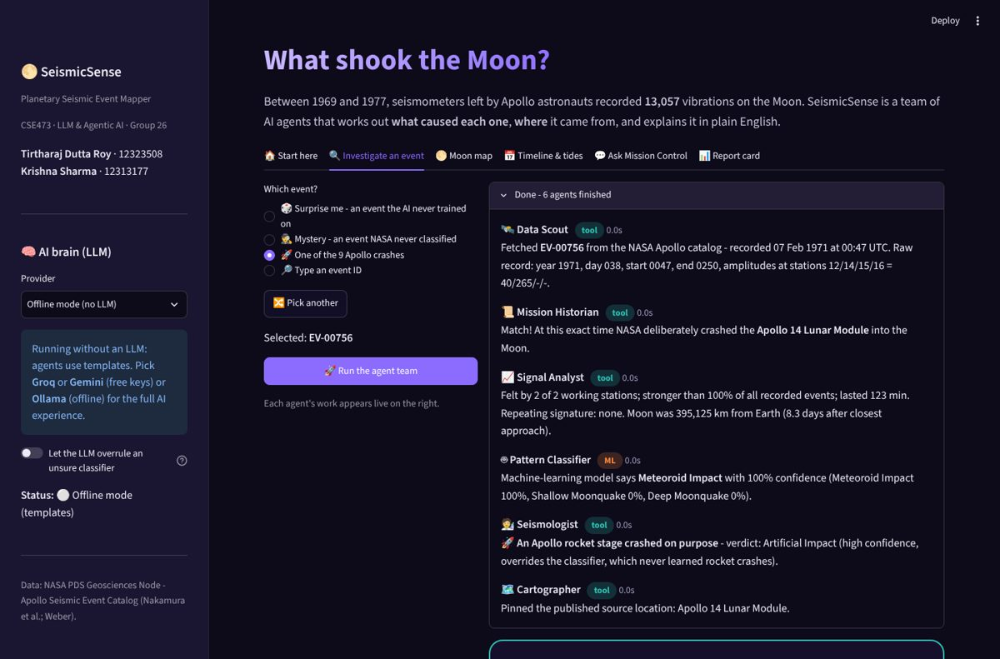
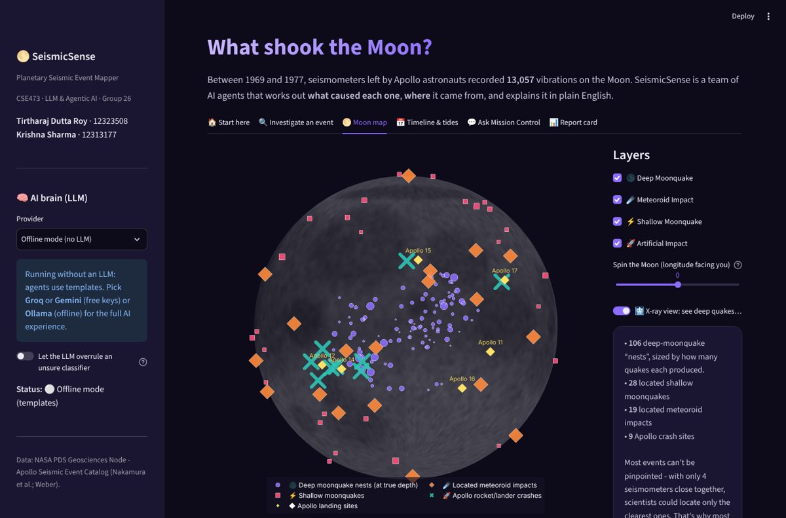
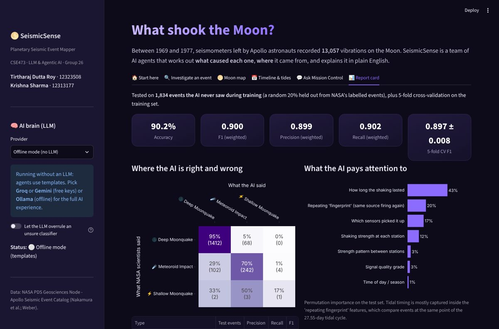

# SeismicSense - Planetary Seismic Event Mapper

**CSE473 - LLM & Agentic AI · Group 26**

| Name | Registration No. |
|---|---|
| **Tirtharaj Dutta Roy** | **12323508** |
| Krishna Sharma | 12313177 |

**Challenge:** NASA Space Apps · *"Make a Moonquake Map 2.0"*
**Problem:** Lunar seismic data is hard to classify and visualise.
**Solution:** A team of cooperating AI agents (LLM + machine learning + tools) that classifies every seismic event
recorded by the Apollo seismometers (1969-1977), plots it on an interactive 3D Moon and a timeline, and explains
each result in plain English for people with no seismology background.



---

##  How to run (3 steps, ~2 minutes)

**Requirements:** Python 3.10 or newer (tested with Python 3.13, including older library versions: pandas 2.2, scikit-learn 1.5, Streamlit 1.50). Internet is needed only for the first install.

```bash
# 1. open a terminal inside this folder, then install the libraries
pip install -r requirements.txt

# 2. start the app (it opens in your browser at http://localhost:8501)
streamlit run app.py
```

**3.** *(Optional, recommended)* Connect an LLM in the left sidebar - see below.

**One-click alternative:** double-click `run_windows.bat` (Windows) or run `bash run_mac_linux.sh` (macOS/Linux).
It creates a virtual environment the first time and then launches the app.

The trained model is already included, so the app starts in about 5 seconds. If the model file ever fails to load
(e.g. a very different scikit-learn version), the app automatically retrains it (~1 minute) - nothing to do by hand.

### Connecting the LLM (pick ONE)

| Option | Cost | How |
|---|---|---|
| **Groq** (recommended) | Free | Create a key at https://console.groq.com/keys → sidebar: *Provider = Groq*, paste key, press **🔌 Test** |
| **Google Gemini** | Free | Key at https://aistudio.google.com/apikey → *Provider = Google Gemini* |
| **Ollama** (no internet) | Free | Install https://ollama.com, run `ollama pull qwen2.5:7b` → *Provider = Ollama* |
| OpenAI / any OpenAI-compatible server | Paid / self-hosted | Paste key / endpoint |

- Press **📋 Models** to fetch the models your provider offers right now (providers rename models often).
- To avoid pasting the key every time: copy `.env.example` to `.env` and fill in the key.
- **No key? The app still works** in *Offline mode*: every agent falls back to deterministic templates and the
  UI clearly says so. This guarantees the demo can never fail because of the internet.

---

## 2-minute demo script (for the evaluator)

1. ** Start here** - the four kinds of "moonquakes" in plain English and the agent team.
2. ** Investigate an event** → choose * Surprise me* → ** Run the agent team**.
   Watch 6 agents work live, then see the verdict, the LLM's explanation, the probabilities, whether it matches
   NASA scientists' label, and where on the Moon it happened. Try * Mystery* to classify an event NASA never labelled,
   or * Apollo crashes* to see the Mission Historian override the ML model.
3. ** Moon map** - drag to spin the 3D Moon; switch on ** X-ray view** to see deep moonquakes ~900 km inside the Moon.
4. ** Timeline & tides** - 8 years of activity, plus the *tidal heartbeat*: deep moonquakes follow Earth's 27.55-day pull.
   Press ** Write briefing** for an LLM-written "Moon news" summary of any year.
5. ** Ask Mission Control** - ask anything, e.g. *"What were the 5 strongest meteoroid impacts?"*.
   Open ** Tools the agent used** to see the LLM's tool calls.
6. ** Report card** - accuracy, F1, confusion matrix and ** Run live evaluation** of the LLM Seismologist.



---

##  How the agentic AI works

```
                               ┌──────────────────────────────────────────────┐
  Your question  ──────────►   │   MISSION CONTROL  (LLM, tool-calling)     │
                               │  plans → calls tools → reads results → answers│
                               └──────┬───────────┬───────────┬────────────────┘
                                      │           │           │
       catalog_stats / find_events  analyze_event  show_moon_map / show_timeline / show_tidal_pattern / model_report

  Classification council (runs for every event you inspect):
   Data Scout ─►  Mission Historian ─►  Signal Analyst ─►  Pattern Classifier ─►  Seismologist ─►  Cartographer
     (tool)          (mission records)        (physics/stats)       (ML model)             (LLM)               (3D map)
```

| Agent | Role | Powered by |
|---|---|---|
|  **Data Scout** | Retrieves the raw record from the NASA catalog | Tool |
|  **Mission Historian** | Checks Apollo mission records: was a rocket stage / lunar module crashed at that minute? | Tool |
|  **Signal Analyst** | Converts numbers into evidence: strength vs. all events, duration, which stations felt it, Earth-Moon distance, and whether the same "fingerprint" repeated 1-3 lunar months earlier/later | Tool |
|  **Pattern Classifier** | Gradient-boosted trees trained on 7,336 NASA-labelled events → probabilities | scikit-learn |
|  **Seismologist** | Receives *all* evidence + ML probabilities, reasons with domain knowledge, gives verdict, confidence, 3 evidence-based reasons, a plain-English story and a caveat (structured JSON) | **LLM** |
|  **Cartographer** | Pins the published source location or shows how strongly each station felt it | Tool |
|  **Mission Control** | Conversational agent: decides which of 7 tools to call (multi-step, up to 6 rounds), combines results, answers and shows charts | **LLM with function calling** |
|  **Storyteller** | Writes the yearly "Moon news" briefing from computed statistics | **LLM** |

**Why not let the LLM classify on its own?** LLMs are poor at precise numeric pattern recognition over thousands of
examples. The agentic design gives each part the job it is good at: the ML model does the pattern matching
as a *tool*, and the LLM plans, cross-examines the evidence, catches doubtful cases, explains, and talks to the user.
Decision policy: Mission Historian is definitive for rocket crashes; otherwise the classifier's answer is kept and the LLM's
disagreement is shown as a second opinion. Turning on *"Let the LLM overrule an unsure classifier"* lets the LLM decide
when the classifier is less than 60% sure.

All LLM providers are reached through one OpenAI-compatible client (`seismicsense/llm.py`), so the same agent code runs
on Groq, Gemini, Ollama, OpenAI, LM Studio, etc.

---

##  Results

Evaluated on **1,834 events never seen during training** (stratified random 20% hold-out of NASA's labelled
natural events) plus 5-fold cross-validation on the training set (`python train.py` reproduces everything).

| Metric (held-out test set) | Score |
|---|---|
| **Accuracy** | **0.902** |
| **F1 (weighted)** | **0.900** |
| Precision (weighted) | 0.899 |
| Recall (weighted) | 0.902 |
| 5-fold CV F1 (weighted) | 0.897 ± 0.008 |
| Full 4-class pipeline incl. Mission Historian | accuracy 0.903 · F1 0.901 |

| Event type | Test events | Precision | Recall | F1 |
|---|---|---|---|---|
|  Deep moonquake | 1,480 | 0.931 | 0.954 | 0.943 |
|  Meteoroid impact | 348 | 0.773 | 0.695 | 0.732 |
|  Shallow moonquake | 6 | 0.200 | 0.167 | 0.182 |
|  Artificial impact (Mission Historian) | 9 | 1.000 | 1.000 | 1.000 |

**Notes:**
- Only 28 shallow moonquakes exist in the entire 8-year record (6 in the test set). In catalog numbers they look like
  meteoroid impacts; NASA scientists separated them using high-frequency waveform details that the catalog doesn't contain.
  So the *macro* F1 (unweighted average of the 3 natural classes) is 0.62, while the *weighted* F1, which counts each
  event equally, is 0.90.
- No information that reveals the answer is used as input: the nest ID, comments and type columns are never features.
  All "context" features (repeating fingerprints, nearby activity) are computed without labels.
- The features that helped most were the lunar tidal geometry (Meeus ephemeris) and the "fingerprint" features. Deep moonquake nests re-fire every anomalistic month (27.55 days) with the same pattern
  across stations, while impacts never repeat.




---

##  Dataset

All data comes from the **NASA Planetary Data System (PDS) Geosciences Node - Apollo Seismic Event Catalog**:
https://pds-geosciences.wustl.edu/missions/apollo/seismic_event_catalog.htm
(data folder: https://pds-geosciences.wustl.edu/lunar/urn-nasa-pds-apollo_seismic_event_catalog/data/).
The needed CSV files are small (≈0.9 MB) and are **already included** in `data/raw/`.

| File | Contents |
|---|---|
| `levent.1008weber.csv` | Y. Nakamura's long-period event catalog (13,057 events), edited by R. C. Weber - **main training data** |
| `nakamura_2005_dm_locations.csv` | Locations and depths of 106 deep moonquake nests |
| `nakamura_1983_ai_locations.csv` | Times and locations of Apollo artificial impacts |
| `nakamura_1979_sm_locations.csv` | Locations of 28 shallow moonquakes |
| `gagnepian_2006_catalog.csv` | Located meteoroid impacts (Gagnepain-Beyneix et al., 2006) |

Event type codes (column `T2`) were decoded and verified against the official counts in Nunn et al. (2020), Table 8:
`A`, `M` = deep moonquake (7,399) · `C` = meteoroid impact (1,743) · `H` = shallow moonquake (28) ·
`S`, `L` = Saturn S-IVB / Lunar Module impacts (9) · blank/`T`/`X`/`Z` = unclassified, tentative, thermal or short-period (3,878).

---

##  Project structure

```
CSE473_26_12323508_12313177/
├── app.py                  # Streamlit interface (6 tabs)
├── train.py                # re-trains the classifier, writes reports/metrics.json
├── evaluate_agents.py      # measures the LLM Seismologist vs the classifier on test events
├── seismicsense/
│   ├── catalog.py          # data loading, feature engineering, tidal ephemeris, locations
│   ├── model.py            # Pattern Classifier + Mission Historian + evaluation
│   ├── agents.py           # all agents, council pipeline, Mission Control tool-calling loop
│   ├── llm.py              # OpenAI-compatible client for Groq / Gemini / Ollama / OpenAI + JSON parsing
│   └── viz.py              # offline 3D Moon globe, timeline, tidal heartbeat, report charts
├── data/raw/               # NASA PDS catalog CSVs
├── models/                 # trained classifier (.joblib)
├── reports/metrics.json    # test metrics (generated by train.py)
├── docs/                   # screenshots used in this README
├── .streamlit/config.toml  # dark space theme
├── .env.example            # template for LLM API keys
├── requirements.txt
└── run_windows.bat / run_mac_linux.sh
```

Useful commands:
```bash
python train.py                                   # retrain + regenerate metrics (~1 min)
python evaluate_agents.py --provider groq --n 30  # LLM Seismologist vs classifier vs NASA labels
```

---

##  References

- Nakamura, Y. et al. (1981, updated 2008). *Passive Seismic Experiment Long-Period Event Catalog.* UTIG Tech. Rep. 18.
- Weber, R. C. (2020). *PDART: Apollo Passive Seismic Experiment Expanded Event Catalog.* NASA PDS.
- Nakamura, Y. (2005). Farside deep moonquakes and deep interior of the Moon. *JGR* 110, E01001.
- Nunn, C. et al. (2020). Lunar Seismology: A Data and Instrumentation Review. *Space Sci. Rev.* 216, 89.
- Bulow, R. C. et al. (2007). Temporal and spatial properties of some deep moonquake clusters. *JGR* 112, E09003.
- Meeus, J. (1998). *Astronomical Algorithms*, ch. 47 (lunar position).
- NASA Space Apps Challenge - *Make a Moonquake Map 2.0*.
